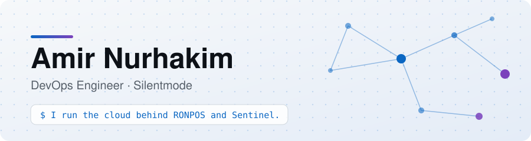
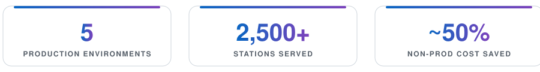
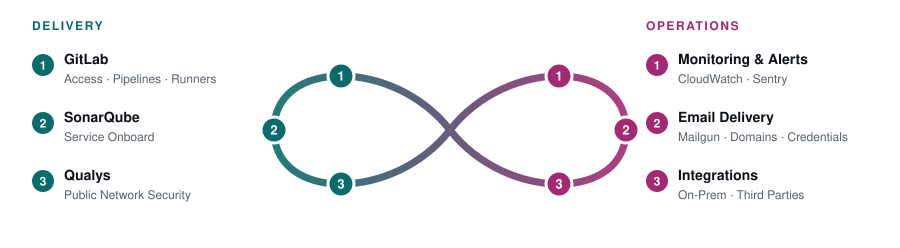
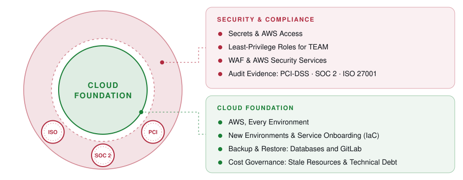
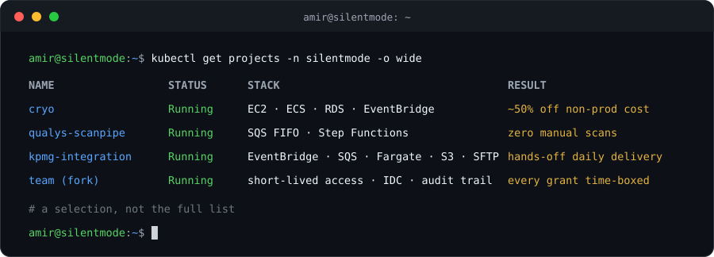
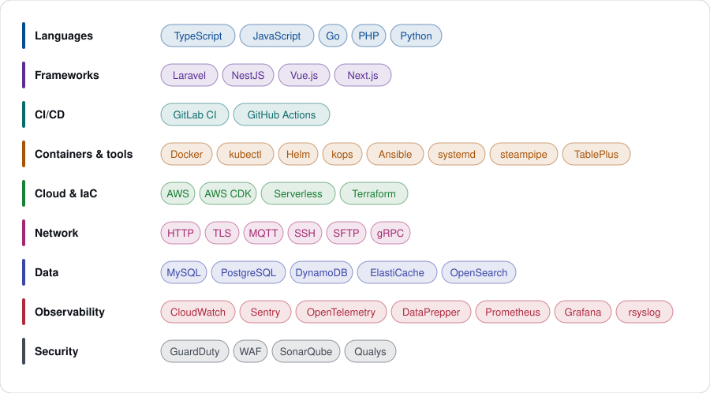

<picture>
  <source media="(prefers-color-scheme: dark)" srcset="assets/banner-dark.svg">
  
</picture>

**DevOps Engineer** (*previously Software Engineer*) @ [Silentmode](https://www.silentmode.my/) &nbsp;·&nbsp; **CS (Multimedia) Graduate** @ [UPM](https://www.upm.edu.my/)

 

<picture>
  <source media="(prefers-color-scheme: dark)" srcset="assets/stats-dark.svg">
  
</picture>

Shell MY · Shell SG · BHP · Petronas · XCel · FIVE

## Infrastructure

<picture>
  <source media="(prefers-color-scheme: dark)" srcset="assets/infra-loop-dark.svg">
  
</picture>

<picture>
  <source media="(prefers-color-scheme: dark)" srcset="assets/defense-dark.svg">
  
</picture>

<b>Production Incidents</b> · across every environment

 

<picture>
  <source media="(prefers-color-scheme: dark)" srcset="assets/incidents-dark.svg">
  
</picture>

## Projects

## Stack

<picture>
  <source media="(prefers-color-scheme: dark)" srcset="assets/stack-dark.svg">
  
</picture>

## Goals

- [ ] **AWS Certified Solutions Architect – Associate** (SAA-C03)

Jack of all trades, master of none, but often times better than master of one.

