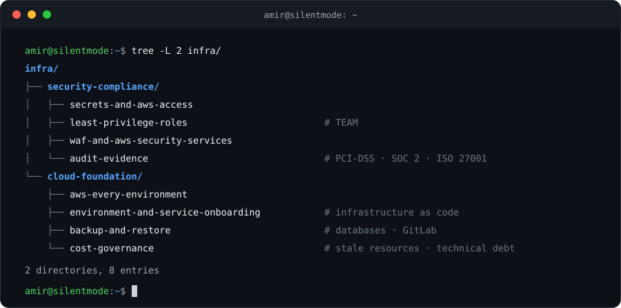

<picture>
  <source media="(prefers-color-scheme: dark)" srcset="assets/banner-dark.svg">
  
</picture>

**DevOps Engineer** @ [Silentmode](https://www.silentmode.my/) &nbsp;·&nbsp; **CS (Multimedia) Graduate** @ [UPM](https://www.upm.edu.my/)

 

<picture>
  <source media="(prefers-color-scheme: dark)" srcset="assets/stats-dark.svg">
  
</picture>

Shell MY · Shell SG · BHP · Petronas · XCel · FIVE

## Infrastructure

I own and maintain the cloud infrastructure of **RONPOS** for Shell MY, Shell SG, BHP, XCel and FIVE, and of **Sentinel** for Petronas: how code ships, where it runs, and how it stays secure, observable and cost-efficient.

<picture>
  <source media="(prefers-color-scheme: dark)" srcset="assets/infra-loop-dark.svg">
  
</picture>

Trusted with production incidents across every environment.

<b>Incidents I've handled</b>

 

- **Databases:** Aurora MySQL 5.7 → 8.0 upgrade regressions · connection exhaustion · deadlocks · long-running queries locking tables · tenant DB performance degradation · temp-table-full errors after a major upgrade
- **Search and storage:** OpenSearch out of disk · JVM memory pressure · silent bulk-insert failures that went unnoticed for weeks · unbounded index retention
- **Pipelines and queues:** Kinesis and SQS backlogs · delayed transaction processing · queue-worker out-of-memory · full disks · Lambda timeout and memory tuning
- **MQTT and station fleet:** broker CPU exhaustion · fuel price updates not reaching stations · fleet-wide cloud disconnects traced to a customer's network path · stale Redis connections in the socket workers · socket.io 404s found across multiple environments
- **Edge and network:** WAF Bot Control blocking legitimate traffic · gateway timeouts and 5xx on login and report pages · a security-hardening change that cut off internal connectivity
- **Third parties:** payment-authorization service outages · integration RPC timeouts · email delivery blocklisted by a mail provider · e-invoice submission failures
- **Platform:** GitLab runners hanging CI jobs · flaky end-to-end pipelines · a full AWS account migration cutover
- **Follow-up:** RCA write-ups

## Projects

## Stack

<picture>
  <source media="(prefers-color-scheme: dark)" srcset="assets/stack-dark.svg">
  
</picture>

## Goals

- [ ] **AWS Certified Solutions Architect – Associate** (SAA-C03)

Jack of all trades, master of none, but often times better than master of one.

