# F1 animation options

Preview only. Not linked from the README. All are original artwork, self-hosted SVG.

### 0. Current: car driving along the road (6s loop)

### 1. Lights out (9s loop)
Five red lights come on one by one, go out, and the car launches.

### 2. Shift lights (4s loop)
Steering-wheel LEDs fill green, red, blue, then flash.

### 3. Pit stop (9s loop)
The car pulls into the box, the crew appears, tyres change from soft (red) to medium (yellow), and it leaves.

### 4. Lap on a circuit (9s loop)
A car follows the racing line, with sector times appearing: S1, S2, then the lap.

### 5. Chequered flag (1.1s wave)

